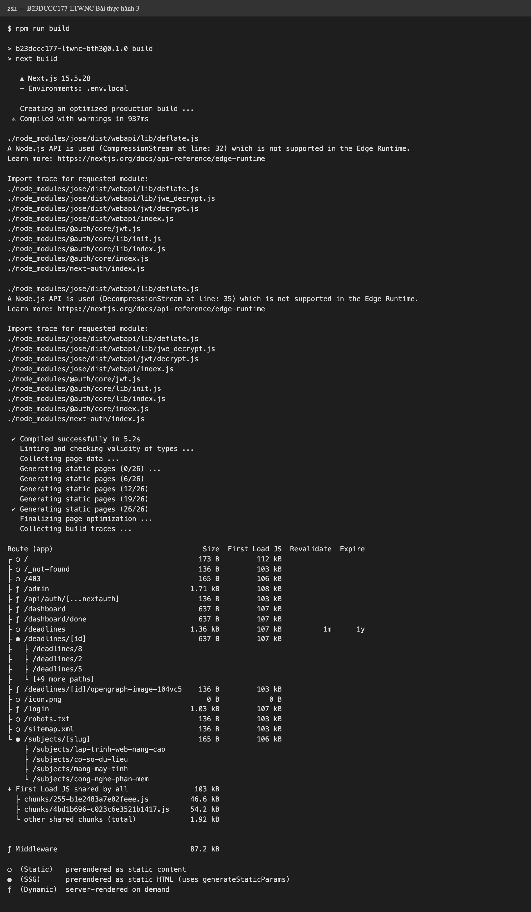
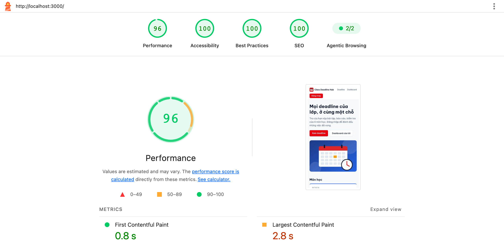
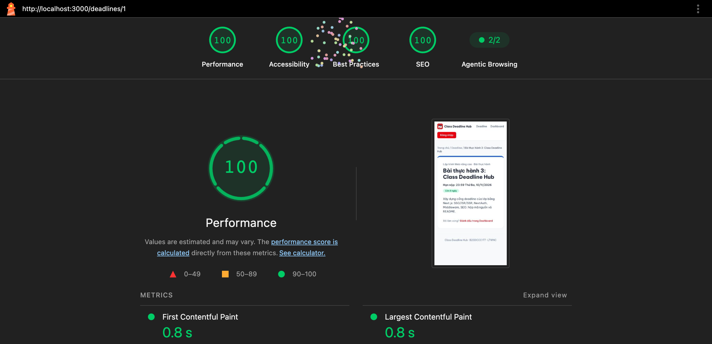
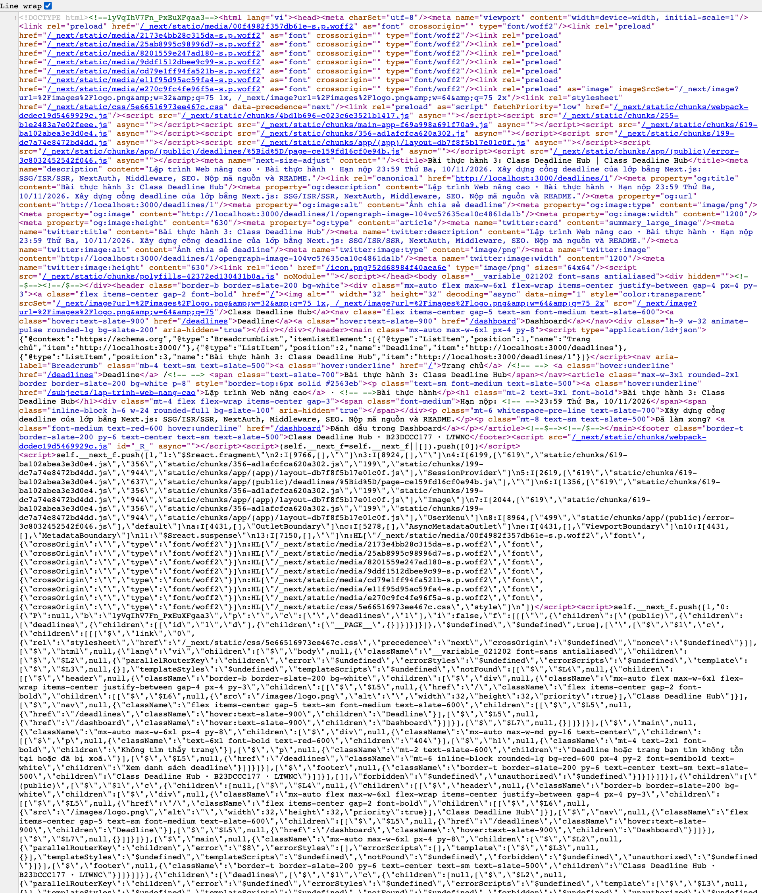

# Class Deadline Hub - BTTH 3 LTWNC

MSSV: B23DCCC177

Web xem deadline của lớp. Dùng Next.js 15 (App Router), NextAuth v5, TypeScript, Tailwind.
Dữ liệu lưu trong file JSON ở thư mục `data/` (4 môn, 12 deadline).

Link deploy: https://b23dccc177-ltwnc-bth3.vercel.app

Tài khoản:

- admin@ptit.edu.vn / admin123 (admin)
- sv@ptit.edu.vn / sv123456 (user)

## Cách chạy

```bash
npm install
cp .env.example .env.local
# điền AUTH_SECRET vào .env.local (tạo bằng npx auth secret)
npm run build
npm start
```

Mở http://localhost:3000. Chạy test: `npm test`.

## Kết quả build và chiến lược render



- `/` - SSG. Trang giới thiệu và danh sách môn học, không đổi khi thêm/xoá deadline nên build sẵn luôn.
- `/subjects/[slug]` - SSG. 4 môn biết trước nên dùng generateStaticParams, slug sai thì 404.
- `/deadlines` - ISR, revalidate 60s. Danh sách có thay đổi nhưng không cần cập nhật ngay, cứ 60s build lại một lần.
- `/deadlines/[id]` - ISR on-demand. Trang cần SEO nên để tĩnh, khi admin thêm/xoá thì gọi revalidatePath để build lại trang đó ngay. Id mới thêm sau khi build vẫn vào được (dynamicParams = true).
- `/dashboard` - SSR. Mỗi người thấy trạng thái "đã xong" khác nhau nên phải render theo từng request.
- `/admin` - SSR. Chỉ admin vào được, cần dữ liệu mới nhất và kiểm tra quyền mỗi lần vào.

## Các phần đã làm

Routing:

- Hai route group `(public)` và `(app)`, mỗi nhóm có layout riêng.
- `/dashboard` có layout con với sidebar, mục đang mở được tô màu.
- Có `error.tsx` (nút "Thử lại"), `not-found.tsx`, `loading.tsx`.
- Chỉ dùng `'use client'` cho đếm ngược (Còn X ngày / Quá hạn Y ngày), bộ lọc, menu user trên header, sidebar, các form.

Đăng nhập và phân quyền:

- NextAuth với Credentials, session kiểu JWT. Session có `id` và `role`, role có kiểu `"user" | "admin"` (khai báo ở `types/next-auth.d.ts`).
- Header hiện tên, vai trò, nút đăng nhập/đăng xuất.
- Ma trận phân quyền viết ở `lib/permissions.ts`, dùng hàm `can(role, action)`.
- Middleware chặn `/dashboard` và `/admin`: chưa đăng nhập thì về `/login?callbackUrl=...`, user vào `/admin` thì về `/403`.
- Trang `/admin` và các server action đều tự gọi `can()` để kiểm tra lại, dữ liệu nhập được validate bằng zod.

SEO:

- `/deadlines/[id]` có generateMetadata và ảnh chia sẻ riêng cho từng deadline (`opengraph-image.tsx`).
- Có `sitemap.xml` (gồm tất cả deadline) và `robots.txt` (chặn `/dashboard`, `/admin`). Trang `/login` và `/dashboard` để noindex.
- Trang chi tiết có JSON-LD BreadcrumbList.
- Dùng `next/font` (Be Vietnam Pro, có subset vietnamese) và `next/image`.

Ảnh chia sẻ của deadline 1:


## Lighthouse

Đo trên bản production (`npm run build` + `npm start`), chế độ mobile mặc định. File báo cáo ở `docs/lighthouse/`.

| Trang | Performance | Accessibility | Best Practices | SEO |
|---|---|---|---|---|
| `/` | 96 | 100 | 100 | 100 |
| `/deadlines/1` | 100 | 100 | 100 | 100 |





## View-source /deadlines/1

HTML trả về đã có sẵn title, meta, og, JSON-LD và nội dung deadline.



## Trả lời câu hỏi

**1. Vì sao /deadlines/[id] dùng ISR?**

Trang chi tiết là trang public, cần Google index được và share link có ảnh preview, nên để tĩnh thì tải nhanh và có sẵn HTML. Nhưng deadline có thể bị admin thêm hoặc xoá. Nếu dùng SSG thì phải build lại cả project mới cập nhật, còn SSR thì request nào cũng phải render lại dù dữ liệu ít khi đổi. Dùng ISR on-demand thì vẫn là trang tĩnh, chỉ khi admin thêm/xoá mới gọi `revalidatePath` để build lại đúng trang đó. Deadline bị xoá sẽ thành 404 ngay.

**2. Nếu chỉ dùng Middleware để bảo vệ /admin thì có rủi ro gì?**

- Middleware chỉ chặn theo đường dẫn trong `matcher`. Server action thực chất là request POST có thể gọi thẳng, nếu action không tự kiểm tra quyền thì người không phải admin vẫn thêm/xoá được.
- Nếu `matcher` viết sai hoặc sau này thêm route mới mà quên thêm vào thì trang đó không được bảo vệ.
- Middleware có thể bị bypass, ví dụ lỗ hổng CVE-2025-29927 của Next.js cho phép bỏ qua middleware bằng header `x-middleware-subrequest`.

Vì vậy trong bài trang `/admin` và các action đều kiểm tra quyền lại bằng `can()`.

## Điểm cộng

- Test Jest cho `can()`: `npm test`, 13 test.
- Deploy Vercel: https://b23dccc177-ltwnc-bth3.vercel.app. Vercel không ghi file được nên trên Vercel dữ liệu lưu vào Upstash Redis (có biến môi trường `KV_REST_API_URL`, `KV_REST_API_TOKEN` thì dùng Redis, không có thì dùng file JSON như bình thường).
- Đăng nhập GitHub: tạo OAuth App trên GitHub, callback URL là `<domain>/api/auth/callback/github`, rồi điền `AUTH_GITHUB_ID` và `AUTH_GITHUB_SECRET` vào `.env.local` (hoặc Environment Variables trên Vercel). Có 2 biến này thì trang đăng nhập hiện thêm nút GitHub. Tài khoản GitHub đăng nhập vào có role user.

## Ghi chú

`loading.tsx` em để ở `/subjects/[slug]` chứ không để ở `/dashboard`. Lúc test bản production, để loading bọc trang dashboard thì bấm "Đánh dấu đã xong" lần đầu sau khi tải trang không cập nhật giao diện. Còn để ở `/deadlines/[id]` thì deadline không tồn tại trả về status 200 thay vì 404.
